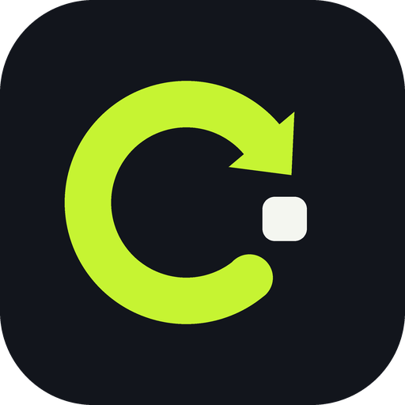
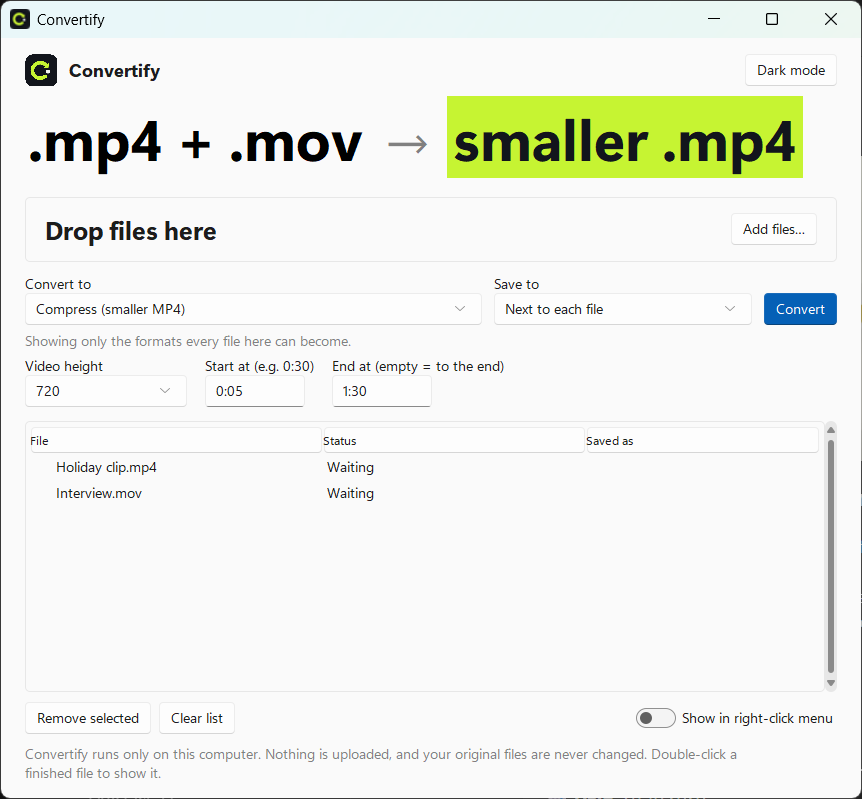
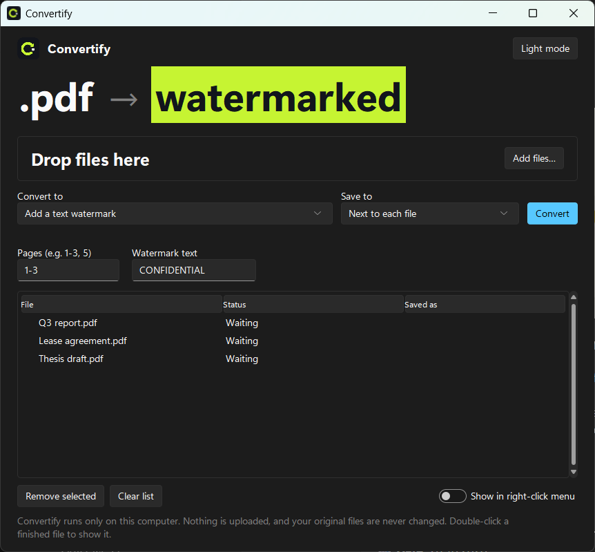

<p align="center">
  
</p>

<h1 align="center">Convertify</h1>

<p align="center">
  <b>Convert, compress and fix any file from the Windows 11 right-click menu. Fully offline.</b><br>
  PDF tools, office documents, e-books, images, audio, video, spreadsheets, archives and OCR in one small app.
</p>

<p align="center">
  
  
  
  
  
</p>

Right-click a file → **Convert with Convertify** → **PDF / DOCX / PPTX / smaller PDF**. The result appears
next to the original. Open the app for everything else: lock a PDF, add a watermark, shrink a video, pull the
audio out of a clip, turn a folder of photos into a GIF, zip a batch of files.

No server, no account, no uploads. Everything runs on your PC with free, open-source tools.



---

## Contents

1. [What it can do](#what-it-can-do)
2. [What's new compared to File Converter](#whats-new-compared-to-file-converter)
3. [Install (5 minutes)](#install)
4. [Using it](#using-it)
5. [How it works](#how-it-works)
6. [Add your own conversion](#add-your-own-conversion)
7. [Troubleshooting](#troubleshooting)
8. [Uninstall](#uninstall)

---

## What it can do

### Convert

| From | To |
|---|---|
| PDF | Word, PowerPoint (picture slides), text, HTML, PNG/JPG per page |
| Word (DOCX, DOC, ODT, RTF) | PDF, PowerPoint, PNG/JPG per page, HTML, ODT, DOCX, text, Markdown, **EPUB** |
| PowerPoint (PPTX, PPT, ODP) | PDF, PNG/JPG per slide |
| Excel (XLSX, XLS, ODS, CSV, **TSV, JSON**) | PDF, CSV, **TSV**, XLSX, HTML, JSON |
| Markdown, HTML, TXT | PDF, Word, HTML / Markdown, **EPUB** |
| **E-books (EPUB)** | **PDF, Word, HTML, Markdown, text** |
| Images (PNG, JPG, WEBP, **AVIF**, BMP, GIF, TIFF, HEIC, ICO) | Any of these, or PDF |
| Video (MP4, MOV, AVI, MKV, WEBM) | MP4, WebM, **MOV, MKV**, animated GIF, MP3 / **WAV / M4A / FLAC / OGG** audio |
| Audio (MP3, WAV, M4A, OGG, FLAC, **AAC, OPUS, WMA**) | Any of these |
| Scanned PDF or photo of text | Searchable PDF, or plain text (OCR) |

### Edit and fix

| File | Action |
|---|---|
| PDF | **Compress**, **rotate pages**, **lock with a password**, **remove a password**, **add a text watermark**, **add page numbers**, **extract embedded pictures**, split into pages |
| Video | **Compress to a smaller MP4**, **save a thumbnail picture**, **remove the sound**, **trim** (start / end time) |
| Audio | **Even out the volume** (loudness normalization), **trim** |
| ZIP | **Extract all files** |

### Combine several files into one

| Files | Into |
|---|---|
| Several PDFs | One merged PDF |
| Several images | One PDF, or **one animated GIF** |
| **Any files** | **One .zip** |

**Bold** = added in Convertify.

---

## What's new compared to File Converter

Convertify is built on [File Converter](https://github.com/Ahany1440/file-converter), the project my friend
and I worked on. It keeps everything that made that app good (the right-click menu, the safe conversion
pipeline, the tests) and adds:

| | File Converter | Convertify |
|---|---|---|
| Conversions in the map | 200 | **335** |
| Input file types | 33 | **41** |
| "Many files into one" actions | 2 | **4** |
| PDF tools | merge, split | merge, split, **compress, rotate, lock, unlock, watermark, page numbers, extract images** |
| Video tools | convert | convert, **compress, trim, mute, thumbnail**, MOV/MKV output, lossless audio extraction |
| Formats | | **EPUB, AVIF, TSV, JSON input, AAC, OPUS, WMA, ZIP** |
| Right-click menu | PDF / DOCX / PPTX | PDF / DOCX / PPTX / **PDF (smaller file)** |
| Brand | | new name, logo and lime-on-ink theme |

Both apps can be installed side by side: Convertify uses its own registry key, menu package and COM class ID.

---

## Install

### 1. Install the converters

Convertify drives these free programs. Open **Terminal** and run:

```bash
winget install Python.Python.3.13
```
```bash
winget install TheDocumentFoundation.LibreOffice
```
```bash
winget install JohnMacFarlane.Pandoc
```
```bash
winget install Gyan.FFmpeg
```
```bash
winget install UB-Mannheim.TesseractOCR
```

You can skip any of the last four. The app turns off only the formats that need the missing program and
tells you how to install it.

| Program | Needed for |
|---|---|
| LibreOffice | Word / PowerPoint / Excel → PDF and images |
| Pandoc | Markdown, HTML, EPUB, Word → text |
| FFmpeg | all audio and video |
| Tesseract | OCR (scans → searchable PDF / text) |

### 2. Download Convertify

Click **Code → Download ZIP** above and unzip it somewhere **permanent**, for example `C:\Tools\Convertify`.
The right-click menu points to this folder. If you move it later, run `install.bat` again.

Or with git:

```bash
git clone https://github.com/youssef-110/Convertify-.git "C:\Tools\Convertify"
```

### 3. Turn on Developer Mode (for the Windows 11 menu)

**Settings → System → For developers → Developer Mode → On.**

Windows 11 only lets packaged apps into its new right-click menu. Developer Mode lets the included menu
package register without a paid code-signing certificate. Skip this step and the entry still appears under
**Show more options**.

### 4. Run `install.bat`

Double-click it. The first run takes a few minutes while it sets up Python packages. It adds:

- the right-click entry (new Windows 11 menu and the classic one),
- **Convertify** in the Start Menu,
- **Send to → Convertify**, which opens many files at once.

---

## Using it

**Right-click a file:**

```
Convert with Convertify  ▸   Open in Convertify…
                             ───────────────
                             PDF
                             DOCX
                             PPTX
                             PDF (smaller file)
```

The menu keeps to the most-used actions for that file type. A small window shows progress, then
**Show in folder** / **Open**. **Open in Convertify…** opens the full app for everything else.

**In the app:**

- Drag files or whole folders onto the window, or click **Add files…**.
- **Convert to** lists only what works for every file you added.
- **Save to:** next to each file (the default), or a folder you pick.
- Settings appear only when they apply: page range, image quality and size, video height, start / end time,
  rotation, password, watermark text, OCR language.
- Double-click a finished file to show it in Explorer.



**Rules it always follows**

- Your original file is never changed. The app works on a temporary copy.
- Nothing is overwritten. If `report.pdf` exists, you get `report (2).pdf`.
- One file in, several out (a PNG per page, a CSV per sheet, the files in a .zip)? They're saved together in a
  new folder, e.g. `report (png)`.
- Edits get a clear name: `report_compressed.pdf`, `report_locked.pdf`, `clip_small.mp4`, `song_normalized.mp3`.
- A conversion that hangs is stopped after 10 minutes (60 for video).
- Passwords you type are used for that one conversion and never saved.

---

## How it works

The project is small on purpose. Each piece is one file you can read in a few minutes.

```
right-click menu ──┐
Send To / Start ───┼──> gui.pyw ──> core.py ──> converters/ ──> LibreOffice, Pandoc, FFmpeg,
the app window ────┘                                           Tesseract, Python libraries
```

### 1. One conversion map: `converters/__init__.py`

Every conversion is one line:

```python
add(["pdf"], "pdf-compress", "Compress (smaller PDF)", "pdf_tools.compress")
add(WORD, "pdf", "PDF", "libreoffice.convert", needs=["soffice"])
```

That line says: *these input types* → *this output* → *label* → *which function does it* → *which program it needs*.
The app's format list, the right-click menu and the tests are all generated from this map, so adding a
conversion is one line.

### 2. The engines: `converters/*.py`

| File | Uses | Does |
|---|---|---|
| `libreoffice.py` | LibreOffice (`soffice --headless --convert-to`) | Office ↔ PDF |
| `pdf_tools.py` | PyMuPDF, pdf2docx, python-pptx | PDF → text, images, Word, slides; merge, split, compress, rotate, lock, unlock, watermark, number, extract images |
| `pandoc_tools.py` | Pandoc | Word / Markdown / HTML / EPUB ↔ each other |
| `images.py` | Pillow + pillow-heif | all image formats, images → PDF or GIF |
| `sheets.py` | pandas + openpyxl | spreadsheets ↔ CSV / TSV / JSON / HTML |
| `media.py` | FFmpeg | audio and video: convert, compress, trim, mute, thumbnail, normalize |
| `ocr.py` | Tesseract | scans → searchable PDF / text |
| `archive.py` | Python `zipfile` | pack files into a .zip, extract a .zip |
| `tools.py` | | finds those programs, even when they aren't on `PATH` |

### 3. Running safely: `core.py`

`core.convert()` does the careful parts, so the engines can stay simple:

1. Copies the input to a temporary folder. (LibreOffice leaves `~$file.docx` lock files next to whatever it opens.)
2. Runs the engine in a **separate process**, so a broken file can be killed at the time limit instead of
   freezing the app. On a timeout it kills the whole process tree, because `soffice.exe` starts a `soffice.bin` child.
3. Moves the result next to the original under a name that doesn't exist yet.

### 4. The window: `gui.pyw`

Tkinter with the [Sun Valley](https://github.com/rdbende/Sun-Valley-ttk-theme) theme for the Windows 11 look,
and tkinterdnd2 for drag and drop. Conversions run on a worker thread that sends UI updates through a queue
the window reads (`UiQueue`), because Tkinter isn't thread-safe.

`gui.pyw --convert pdf "C:\file.docx"` skips the window and shows only the small progress popup. That's what the
right-click menu runs.

### 5. The right-click menu: `shell.py` and `menu/`

- **Classic menu ("Show more options").** Registry keys under
  `HKEY_CURRENT_USER\Software\Classes\SystemFileAssociations\.<ext>\shell\Convertify`. No admin rights needed.
- **New Windows 11 menu.** A COM object implementing `IExplorerCommand` (`menu/menu.cpp`), shipped in a
  *sparse package* (`AppxManifest.xml`) that `install.bat` registers with
  `Add-AppxPackage -Register AppxManifest.xml -ExternalLocation <folder>`.

The DLL contains no format list. It reads `menu/menu.txt`, which `shell.py` generates from the conversion map.

### 6. The logo: `assets/make_logo.py`

The logo is drawn in code with Pillow: a lime "C" that is also a convert arrow, landing on a file.
Run the script to regenerate every icon size (`icon.ico`, the Store tiles, `docs/logo.png`).

---

## Add your own conversion

Example: add **TGA** images with Pillow.

1. Teach the engine the format, in `converters/images.py`:
   ```python
   PIL_FORMAT = {..., "tga": "TGA"}
   ```
2. Add it to the image list in `converters/__init__.py`:
   ```python
   IMAGES = [..., "tga"]
   ```
3. Run the tests, which now include `png->tga`, `tga->jpg` and the rest:
   ```bash
   .venv\Scripts\python -m pytest tests
   ```

To show an action in the right-click menu too, add its id to `BASICS` in `shell.py` and run `install.bat`.

---

## Troubleshooting

| Problem | Fix |
|---|---|
| Entry only under "Show more options" | Turn on Developer Mode, run `install.bat` again, then restart Explorer |
| A format says *needs LibreOffice* (or another program) | Install it with the `winget` command the app shows, then restart the app |
| PDF → Word layout is off | Expected for complex layouts. A PDF stores positioned text, not paragraphs |
| PDF → PowerPoint text isn't editable | Pages become pictures on slides. Use PDF → Word to edit text |
| "Compress" barely shrank a PDF | It shrinks pictures. A PDF that is mostly text is already small |
| Trim time rejected | Use seconds (`90`) or minutes:seconds (`1:30`) |
| OCR reads only English | Add languages in the Tesseract installer, then type e.g. `ara` or `eng+ara` in **Text language** |
| Something failed | See `logs\converter.log` |

**Known limits:** animated GIF/WEBP keep only their first frame when converted to another image type.
Extracting a .zip puts every file in one folder (subfolders are flattened). Word/PowerPoint → PDF uses the fonts
installed on your PC.

---

## Uninstall

Run `uninstall.bat` (it removes both menus, Send To and the Start Menu entry), then delete the folder.

---

## For developers

```bash
.venv\Scripts\python -m pytest tests
```

355 tests, about two minutes. They generate a sample of every input format, run every conversion in the map, and
open each result with the matching library to prove it's valid. Conversions whose program isn't installed show as
skipped, not passed.

```bash
build_menu.bat
```
Rebuilds `menu\ConvertifyMenu.dll` (needs MinGW g++).

```bash
build_exe.bat
```
Optional standalone `.exe` (PyInstaller).

## Credits

Built on [File Converter](https://github.com/Ahany1440/file-converter) by Ahany1440 and contributors.

## License

MIT. See [LICENSE](LICENSE).
